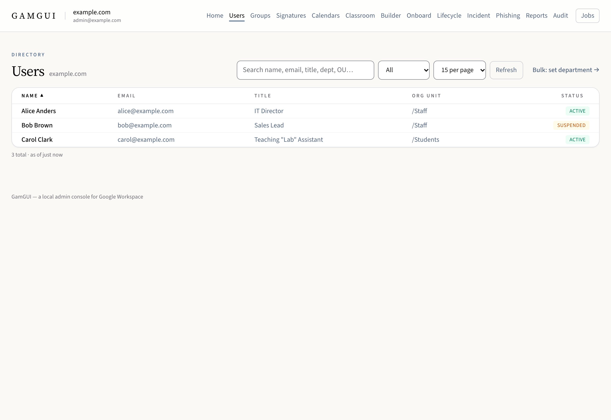
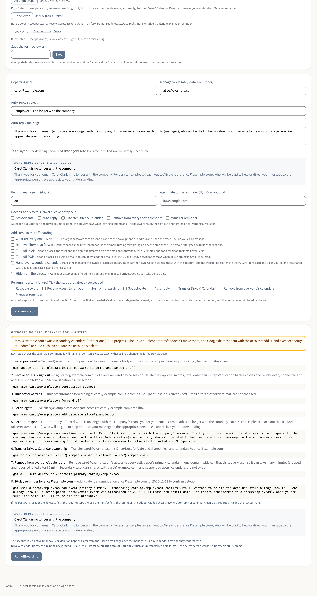
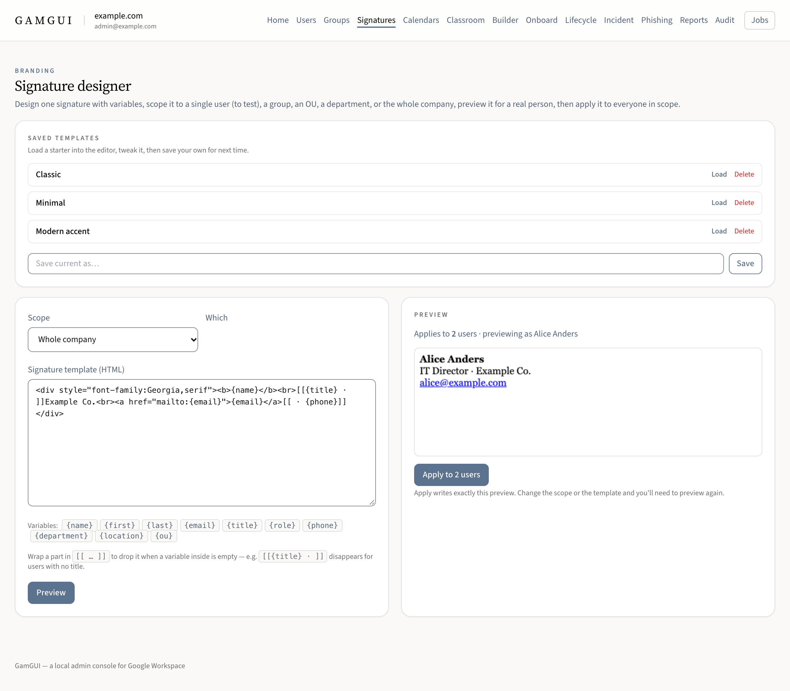
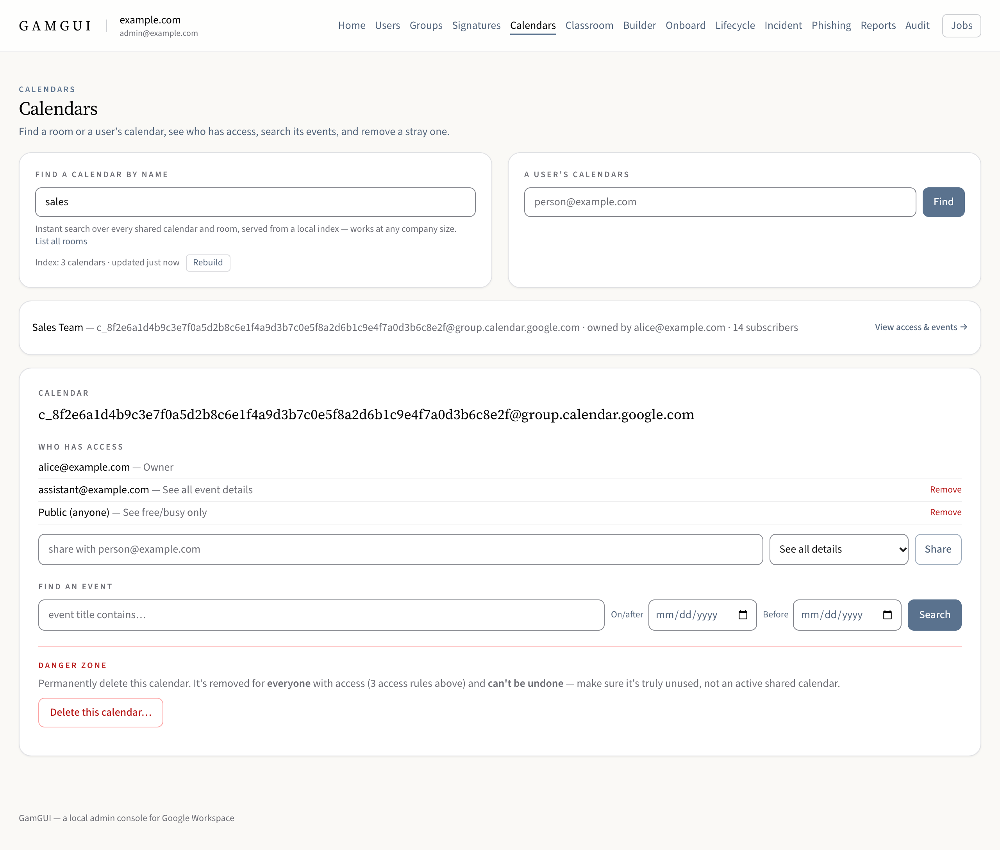

# Using GamGUI

A task guide for the Google Workspace admin who runs GamGUI day to day. It says where each task
lives, what to check before you start, and what to check afterwards. Building the app is in the
[README](../README.md#build-from-source); this page starts once it opens.

Two things hold everywhere:

- **Reading never changes anything.** Searching, opening a person, Reports and every Builder read
  only look. The big changes — onboarding, offboarding, bulk runs, suspend, delete, and anything run
  from the Builder — show a preview first, with the exact `gam` command, and run only after you
  confirm. A single small change (a delegate, a group member, one calendar share) runs when you
  click it; a few ask first. Every change is written to the audit log.
- **"Not yet verified live" means untested on a real domain.** The
  [live verification table](../README.md#live-verification-status) marks each kind of change
  **confirmed** (it has succeeded against a production Google Workspace domain) or **not yet** (the
  offline tests pass and the command matches GAM's documented syntax — nothing more). Run anything
  marked *not yet* once on a test account, group or calendar before you rely on it, and check the
  result in Google yourself.

## First setup

Open **Setup** (every screen points you there until a domain is connected).

1. **Your domain** — type your super-admin email; the primary domain fills itself in.
2. **Import existing credentials** — if you already use GAM, GamGUI lists the GAM folders it found
   (`$GAMCFGDIR`, `~/.gam`) and which credential files each holds. Click **Import** on the right
   one, or give a custom folder. The files are moved into the macOS Keychain. No GAM yet? **Show
   setup commands** gives the exact Terminal commands to create them, then import the result.
3. **Domain-Wide Delegation** — the one step Google makes you do by hand. Setup shows the service
   account's client ID and the scopes GamGUI uses, with Copy buttons. **Authorize in the Admin
   Console** opens Google with both filled in: sign in as a super admin, click **Authorize**, wait
   about 30 seconds, then click **Verify access** back in GamGUI.

   | Scope | What it is for |
   |---|---|
   | `https://www.googleapis.com/auth/calendar` | Calendar sharing, the offboarding sweep and reminder |
   | `https://mail.google.com/` | Gmail (GAM's default); message search |
   | `https://www.googleapis.com/auth/gmail.modify` | Gmail messages and labels (GAM's default) |
   | `https://www.googleapis.com/auth/gmail.settings.basic` | Signatures and auto-replies |
   | `https://www.googleapis.com/auth/gmail.settings.sharing` | Mail delegates and forwarding |
   | `https://www.googleapis.com/auth/drive` | A user's Drive file list |
   | `https://www.googleapis.com/auth/tasks` | Onboarding task lists |
   | `https://www.googleapis.com/auth/cloud-identity.devices` | The computers signed in with an account. Setup's check doesn't ask for this one: without it, only that list is missing |

   Offboarding's sign-out needs one more permission that delegation can't give: the admin token's
   "Directory API - User Security" scope, ticked when `gam oauth create` runs. Setup says whether
   your imported token has it.
4. **Check the header.** Once verified, the top left of every page names the connected domain and
   the admin GamGUI acts as. Glance at it before any change. Click it for Setup: **Check access**
   runs the verify again for the connected domain (when a page says a scope isn't authorized, it
   re-checks the delegated scopes GamGUI's own commands use and links to authorize any that fail),
   and with more than one domain in the Keychain you switch there instead (pick the active one to
   check it). **Remove** deletes another domain's credentials from the Keychain, for one you no
   longer use; to remove the active one, switch away from it first. Domains are stored lowercased,
   so `Example.com` and `example.com` are one domain (an import from before that may have listed
   both: remove the extra one).

macOS asks for Keychain access the first time each credential is used. **Always Allow** sticks only
if the app is signed with a stable certificate — see
[Stop the Keychain prompts](../README.md#stop-the-keychain-prompts).

## Find a user

**Users** lists everyone, cached for speed ("as of …" says how old the list is; **Refresh**
re-reads it). Search by name, email, title, department or org unit, and open a person for their
profile, groups, delegates, vacation responder, signature and calendar sharing.

## Onboard a new hire

**Before:** on **Onboard → Role templates**, check the role you'll use — its org unit, signature,
groups, shared calendars, checklist steps and **Welcome email (when sent)**. Each role sends one of
the emails on **Onboard → Welcome email**: keep a few (say, one for staff and one for contractors)
and pick one per role; a role without a choice sends "Default". An email a role still uses can't
be deleted. Check the new address isn't already taken (search
Users). Creating an account needs a free license: with none left, Google refuses it and GamGUI says
so. A CSV run then skips the rest of its new accounts without trying them, and still runs the rows
for people who already have one.

**One person** — **Onboard → Generate**: name, email, role, manager, and whose Google Tasks gets the
setup checklist. Tick **Create the Google account** to create it, and **Also send the welcome
email to the new hire** if you want one (the preview names which). **Preview** lists every step with its `gam` command; the
button under it (**Create account & run onboarding**, or **Create the task list** without an
account) runs exactly that (change the form and you must preview again). The temporary password
appears once, on a sheet you can copy or print — the new hire must change it at first sign-in.

**Waiting for Google.** A brand-new account takes Google a few minutes to set up, and until then
its signature, its shared calendars and (if the new hire is the assignee) its checklist can't be
set. GamGUI keeps those steps and tries again for about seven minutes, in a **Waiting for Google**
panel under the result; you can leave the screen, the jobs tray keeps track. Anything still not
done after that is listed with GAM's error — set the signature from the person's page and the
calendar from Calendars. (Stopping a CSV run lists those steps instead of retrying them.)

**A CSV of hires** — **Onboard → Bulk import**: download the template CSV, fill one row per hire
(the `role` column picks the template), then **Preview** and confirm. It runs in the background with
live progress. Leave `notify` blank to put each password on the printable sheet, or give a personal
address and Google emails the sign-in details there.

**After:** in the Admin console, check the account exists in the right org unit. Check the groups,
calendars, signature and the checklist in the assignee's Google Tasks. Account creation, the task
list, the welcome email and adding to a group have run on a real domain; the retry for a new
account's signature and calendars has not yet.

## Offboard a leaver

**Lifecycle** runs the whole routine for one person: reset the password → revoke access and sign
out → turn off forwarding → make the manager a delegate → set the auto-reply → transfer Drive and
calendars to the manager → remove the leaver from everyone's calendars → add a reminder to the
manager's calendar. It does not delete the account; do that later from the user's page, once the
transfer has finished.

**Before:** enter the leaver and the manager and click **Preview steps**. Read every warning. GamGUI
refuses to offboard the admin it is connected as — revoking that account's access would cut off
GamGUI mid-run — so connect as a different super admin first if you need to. The routine has run
live, every step succeeding and its effects checked in Google afterwards; for your own first run,
still **work through the
[first live run checklist](domains/lifecycle-offboarding.md#first-live-run-checklist)** with it
open: what to look at in the preview, and what to verify in Google afterwards.

**A step that doesn't fit your process:** tick it under **Doesn't apply to this leaver? Leave a step
out**. Any of the hand-over steps can go: no delegate, no auto-reply, no transfer, no calendar sweep,
no reminder. The preview says what leaving each one out means (no transfer: the files are lost when
the account is deleted), the run skips it without calling the routine incomplete, and the audit log
records what was left out. The password reset, the sign-out and turning off forwarding always run.
Anything beyond these steps, like listing the leaver's Drive files first, is a read in the
**Builder**, which can export the result to a Sheet or CSV.

**While it runs:** the calendar sweep can take minutes. Don't quit the app; to halt it, use
**Stop** (see [Jobs](#jobs-and-stop)).

**After:** the panel should say "Offboarding complete — 8 of 8 steps succeeded". In **Audit**, the
calendar clean-up's record shows "Cannot change your own access level": that is GAM declining to change
the leaver's own calendar, which it visits too, and is expected on every run. If a step failed,
its line says why and later steps that depended on it were not run. Fix the cause, tick the steps
that already succeeded, preview again and run — the checklist covers each failure.

### Save your routine as a template

**Templates** at the top of the page hold the whole form but the two addresses and the "already done" ticks. Click one to fill
the form, then Preview as usual. Type a name and **Save** to keep the form as it is; **Open with this** makes the page start on it.
A template can't leave out the reset, the sign-out or forwarding off.

### Add steps to an offboarding

Under **Add steps to this offboarding**, each is off unless you tick it, and each says what it's for. Every offboarding also
reads the secondary calendars the leaver owns and any Vault holds on them, and warns: Google deletes those calendars with the
account, the transfer doesn't move them, and a held account can't be deleted. Ten or more steps ask you to type `confirm`.

## Roll out a signature

**Signatures** designs one HTML signature with variables such as `{name}` and `{title}`, previews it
for a real person and applies it to a scope: one user, a group, an org unit, a department, a
location or the whole company. The [README](../README.md#email-signatures) lists the variables and
how to host logo images.

**Before:** test on yourself. The scope starts on a single user — the admin you're connected as,
when that is an active user — so the first apply changes only your own signature. Send yourself an
email and check how it looks, including the images, before widening the scope. Apply writes exactly
the people and template the preview showed; more than 25 people asks you to type the count.

**After:** the run shows a ✓ or ✗ for each person. If some failed, **Retry the N that failed** gives
them their own preview and confirm step — just those people.

## Share a calendar

**Calendars** → **Find a calendar by name**. The first time, click **Build index**: a one-time
background scan, minutes on a large domain. Click **View access & events** to see **Who has access**, then share
with a person or group at a role and click **Share**.

Sharing also subscribes the person, so the calendar actually appears in their list. Sharing with a
group subscribes each member as a background job; a group of ten or more asks first, naming the
count, and the job lists anyone it couldn't add. To share one person's own calendar, open them on
**Users** → **Sharing**.

**After:** ask one recipient to confirm they see it. Sharing with a group and unsharing are *not
yet* verified live.

## Find a class (school domains)

**Classroom** lists the active classes and those a teacher hasn't accepted yet. Type part of a class's name to narrow
it, or a teacher's full address and press Enter (or **Find**) to read every class they have, archived ones too. Pick a
class to see its owner, its teachers and its students, each linked to their page on **Users**.

A person's page on **Users** has a Classroom card on its Overview: **Show their classes** lists what they teach and
what they're in. Offboarding someone who owns classes names them in the preview, with **Download the list (CSV)** for
whoever gives them a new owner in Classroom before the account is deleted. Under the class finder, **Who can create
classes** names the Classroom Teachers group; add staff to it on **Groups**.

**Plan an import** reads your student information system's roster export. Export **OneRoster 1.1** as CSV, a full
(bulk) export, then choose its ZIP, or every CSV in its folder, and click **Read the export**. A file it can't use is
refused under the picker with what to export instead, and nothing is kept. One it can read shows its counts and the
**Problems to fix in your SIS**, each kind with its cause and fix; **Issues CSV** gives your SIS team the rows. The
roster is read on this Mac and kept here for 14 days; **Purge it now** deletes it sooner.

GamGUI only reads Classroom: it changes nothing there. Classroom is only on Google Workspace for Education domains, and
GamGUI reads it with the admin's own sign-in, so if the page says it can't read Classroom, **Setup** names the
"Classroom API" scopes to tick in `gam oauth create`. Classroom support hasn't been checked on a real school domain yet.

## Audit external sharing

The **Builder** runs any of GAM's read commands and shows the result as a table. To look for
sharing outside your organization, run a read that lists sharing — for example **Users → Calendars →
Print calendaracls**, or **Users → Drive → Print drivefileacls** — then tick **External only**. It
keeps the rows that mention an address outside your domains; your primary domain, secondary domains,
aliases and their subdomains all count as inside. It filters every row, not just the first page,
and the CSV download takes the filtered rows.

Clicking an address in a result offers follow-ups for that person (delegates, forwarding,
signature, suspend and more). A Builder change only ever runs from its preview.

A wide result? **Hide list** (top right) gives the result the whole width; the Builder remembers
your choice until you click it again ("Show list"). Each value stays on one line: a long one is cut short —
click it to read all of it, or hover. The CSV download always has every value whole.

## Check connected apps and AI agents

Which apps have people given access to their accounts, and how much can those apps do?

1. Open **Reports** and go to **Connected apps & AI agents**. Nothing has been read yet.
2. Click **Read connected apps**. GAM reads one account at a time, suspended accounts aside, at about a second an
   account and up to an hour, so several thousand accounts is the most it can finish. It runs in the background, and
   you can keep working.
3. Read the summary, then the list: apps that look like AI assistants or agents, then apps with broad access (all of
   Gmail or Drive, forwarding, admin, Google Cloud), then the rest. Each shows what it may do and who granted it.

An app is called AI by its name alone, so check an app you don't recognise. If GAM couldn't read an account, the
panel says the list may be missing that account's apps. The list stays until you quit or connect
again, and **Read again** refreshes it. Reading changes nothing. To take an app away from everyone, block it in the
Admin console, under Security → API controls → App access control. It's not yet verified live, so compare the list with
the Admin console's Accessed apps the first time you use it.

## See where an account is signed in

Open a person and choose **Security**. It reads three lists when you open the tab, and changes nothing.

- **Chrome**: the Chrome profiles signed in with their work account, the most recently used first. Saved passwords are never
  shown: Google gives no one those. None can also mean managed profile reporting is off in the Admin console's Chrome settings.
- **Phones and tablets**: what syncs the account, and when it first and last did.
- **Computers**: Windows, Mac, Linux and ChromeOS machines, with a mark on one that looks like a virtual machine. A new one
  nobody recognises, often a virtual machine, is how an attacker's sign-in can show up.

**Set temporary password** gives you one to hand over. Their current password stops working, and Google asks for a new one
when they next sign in. It shows once, after it's set, so copy it then: it isn't in the audit log. Not yet verified live.

Chrome needs a scope picked when GAM was authorized, and Computers needs one delegated in the Admin console. Without one,
that list says which and how to add it, and the others still read. Not yet verified live.

## Respond to an incident
1. Pull the logs and click **Read the logs** on **Investigate**. Findings are there. A sign-in Google flagged that was really the person: **That was them** asks how you know, and it stops making a suspect. **Marked as theirs** lists each, with an **Undo**.
2. Open **Respond**. **Where each account stands** says who the attacker had and whether each is locked. **Still to do** lists what's left, each with its button: Secure opens Check Account, Do It Here opens it with only that fix picked, **Show the events** narrows the logs to the events the item is about, and **Pull again** reads the logs that stopped short for just those accounts.
3. **Done** lists what this app or the logs show finished. **Mark done** is for what no log can show: it asks how it was done, and stays with the incident. It isn't offered for a lock, recovery details or a read, which the logs or this app show.

## Make the incident's report
1. With an incident open and its logs pulled, open **Report**. Each number opens its list, with **Export as CSV**. **What was done** lists every step taken, beside the record that shows it.
2. **The review** holds the summary, the type and severity, the meeting, how they got in, what went well, what to do better, and the plan. Click **Save the review**. It goes in the report as typed.
3. **What this report can't show** says which logs it rests on and what's missing, so read it first. **Export report** makes a zip: the report as a PDF, Markdown and text, each list as a CSV, and every saved read with its SHA-256, to show the evidence unchanged. Then click **Save the export**.

## See what was left on the account
1. **Check account** on **Respond** also lists the computers and phones signed in with the account, the apps with access, and the Apps Script projects in their Drive. A script someone authorized keeps acting for them on its triggers.
2. For each computer, pick **Keep it**, **Block it** or **Take the account off it**. It runs from the same preview as the lock. Blocking can be undone in the Admin console.
3. Listing computers needs the devices scope in Setup's delegation. Without it the check says how to add it, and reads the rest as usual. Blocking one needs the full scope: its read-only form lists them but can't change them.

## See who it reached and where it started
1. On **Respond**, each email the attacker sent has its own list, from the Gmail log: who received it, what bounced, and who's still to warn. Pulling the email from every mailbox doesn't change this list, which is what makes it the record.
2. **Pick the warning** when you've sent one: only emails sent after it are offered, and it counts only for those the log shows it reaching. **Every address it went to** lists them, and **Export as CSV** saves them all. A group it went to is read for its members, so each counts as themselves.
3. On **Investigate**, **Where it started** lists emails the first account received from outside before the attack. **That's the phish** keeps your pick with the incident, with who else here received it. They may have fallen for it too.

## Keep an incident
1. Open **Incident**, then **Keep an incident**. Give it a title and how it came to light, and click **Keep this incident**. It takes the pull you just made, if any, or an export you pick.
2. While it's open, each pull of the logs is saved to it. Add notes with their own time, which can be earlier than now.
3. It stays on this Mac, and opens again after a restart without reading Google: the logs and **Read the logs** show what it has saved.

## Pull the incident logs
1. Open **Incident**, then **Pull the logs**. Enter the people reported, or leave it empty for every account, and how far back to read.
2. Leave the logs ticked, or open **Other logs** for more, and click **Pull logs**. It reads in the background and changes nothing, and each log says how far it has got.
3. Open a log to see its newest events. Google's own warnings are marked. The sign-in log's addresses are listed flagged first: follow one to pull every account by it.
4. Click **Read the logs** for what they add up to: where each account stands, what's still to do, and what the logs show, most serious first. Rules in code find it, and nothing here changes anything: each link opens the screen that does it, with its own preview.
5. A busy log read a day at a time may stop before the end of the window. It says how far it read, and **Read the Rest** goes on from there.
6. Each log has a CSV, and **Export all** saves them with a note of what was pulled. A log that couldn't be read says why, and is never exported as empty.

## Secure a compromised account
1. Open **Incident**, enter the address, and click **Check account**, or open a person's **Security** tab and follow **Secure this account**. It
   reads forwarding, filters, delegates, send-as addresses, the auto-reply, drafts and scheduled emails, recovery details and admin roles, and
   changes nothing. What matters most is said first, and a read that failed is said beside its list, never as "none".
2. Leave the lock's switches as they are or change them: reset the password, sign out everywhere, turn off forwarding, IMAP and POP. Clearing
   recovery details is off to start, since they may be the person's own. Turn the reset off if you already did it in the Admin console.
3. Tick what to undo. Nothing is ticked until you tick it.
4. Click **Preview the steps**, read each step and its command, type the person's address, and click **Secure the account**. It stops if the
   account changed since the check, and the reset failing stops the steps after it. The account is then checked again, with what finished
   switched off, so you can preview the rest.
5. Give the person a new password from their page, then [take what they sent out of every mailbox](#take-a-phishing-email-out-of-every-mailbox).

## Take a phishing email out of every mailbox

1. Open **Phishing** and paste the email's Message-ID (in Gmail, More › Show original), or several, one a line. Click
   **Find copies**. It searches every active mailbox and its Spam in the background, and changes nothing. Suspended accounts aren't searched. It shows one copy's sender and subject, so you can check the ID matched the email you meant.
2. Read who has a copy. A mailbox it couldn't search is listed as that, never counted as clear.
3. Click **Trash the copies**, check the list, and type the number of steps. Each copy goes to that person's Trash, where it
   stays for 30 days, and the sender's Sent copy is kept as evidence. Find again to see what's left.

**List recipients** reads who it was sent to from the sender's own copy, outside your domains first. It may not be everyone, so
it always names Google's own record (Admin console › Reporting › Email Log Search). Both lists export as CSV.

## Jobs and Stop

Longer runs — a signature rollout, a bulk department change, a CSV of hires, an offboarding, a group
calendar share, a Builder sequence, the calendar index, a connected-apps read — run in the background. The **Jobs** button
in the header lists them from any page, with progress, the result and a link back to each one.

The list has one-step changes too, a delegate or a sign-out, so it shows everything that ran since GamGUI started.
The audit log stays the full record.

**Stop** finishes the person or step in hand, then ends and says how many it didn't attempt. An
offboarding asks first, and marks the steps after it "not run: stopped". Jobs live in memory:
**quitting the app ends them**, so let a job finish or Stop it first.

## Read the audit log

**Audit** lists every change GamGUI has made, newest first: when, what, to whom, and the result.
That includes a domain removed on Setup (`remove_domain`), with whether its credentials were
deleted or kept. Filter by action, target or error text, tick **Failures only** to see what went wrong, and **Export
CSV** for a record (the export takes the search and filter on the screen; clear them for the whole log). Passwords never appear in
it. The log stays on this Mac; Google's own Admin console audit log is separate and worth checking
for the changes that matter.

Reading this screen never runs `gam`.
